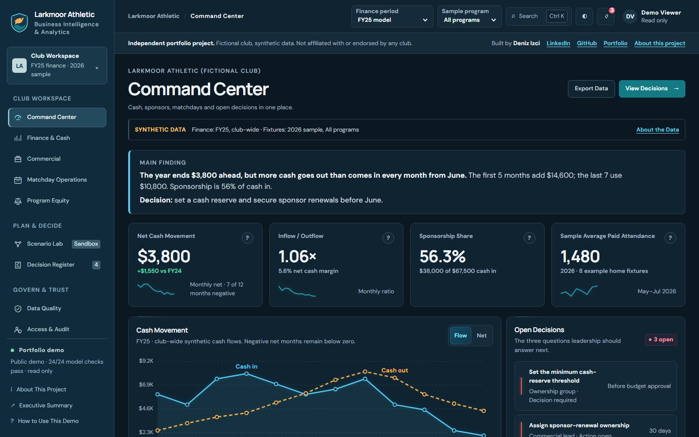

# Club Analytics Hub

A business analysis portfolio project by [Deniz Izci](https://www.linkedin.com/in/denizizci): finance, sponsorship and matchday decisions for a football club.

**[Open the live demo](https://clubanalytics.denizci.dev/)**



> Independent portfolio project. Larkmoor Athletic is a fictional club and all data is synthetic. It is not affiliated with or endorsed by any club, and it has no real users or measured business results.

## Summary

- **Problem:** a small club keeps cash, sponsor, ticketing and fixture records apart, so leaders cannot see whether the year is sustainable.
- **Role:** solo business analysis and product project covering problem framing, requirements, KPI definitions, data model, scenario rules and acceptance criteria, plus directing and reviewing the build.
- **Main finding in the sample data:** the year ends $3,800 ahead, but more cash goes out than comes in every month from June, and sponsorship is 56% of cash in.
- **Tools:** JavaScript, TypeScript, Next.js, PostgreSQL, Power BI, Excel, Playwright, Cloudflare.

## Where to look

| To review         | Start here                                                                                                                                                                              |
| ----------------- | --------------------------------------------------------------------------------------------------------------------------------------------------------------------------------------- |
| Business analysis | [Business case](docs/ba/business-case.md), [requirements](docs/ba/requirements-catalog.md), [traceability](docs/ba/traceability-matrix.md), [KPI dictionary](docs/ba/kpi-dictionary.md) |
| Calculations      | [Methodology](docs/operations/calculation-methodology.md), [scenario engine](site/model.js)                                                                                             |
| Engineering       | [Access policies](lib/auth/policies.ts), [database schema](lib/server/schema.ts), [tests](tests/)                                                                                       |
| BI files          | [Power BI guide](powerbi/README.md), [Excel workbook](outputs/01a128c4-1c8c-71b0-819c-29eaae5a311f/Larkmoor_Analytics_Companion.xlsx)                                                   |
| Hosting           | [Cloudflare setup](docs/operations/cloudflare-hosting.md)                                                                                                                               |

## Two honest modes

The static demonstration is a nine-workspace control room: finance, fixtures, programs, sponsor delivery, acquisition examples, decisions, scenarios, quality and access. It offers fiscal/program filtering, evidence drill-down, searching, sorting, CSV exports, print briefing, responsive navigation and local theme preferences. No private database, credentials or mutation API is published.

The private application uses only records entered into the signed-in organization. A clean organization begins empty. Operations studio supports typed seasons, teams/programs, competitions, venues, fixtures, attendance, receipts, direct/allocated costs, sponsors, deliverables and actions. Approved records feed the dashboards; missing data remains unavailable. Settings and account administration persist. Scenario revisions, comparisons and exports are durable, and writes append audit events in the same transaction.

No ticketing, accounting, banking, email or social integration is implied. Reliable manual and CSV reporting is the implemented route.

## Quick start: static demonstration

Requirements: Node.js 24, npm.

```sh
npm ci
npm run data:build
npm run site:preview
```

Open `http://127.0.0.1:4173`. `npm run site:build` prepares `dist/`; it does not publish. Static calculations share the scenario engine with the native application.

## Quick start: private application

Use a dedicated development PostgreSQL database. The supplied Compose database is loopback-only and has a development-only password; it is not a production service.

```sh
docker compose up -d postgres
# Copy .env.example to .env.local using your shell.
# Set DATABASE_URL, a new SESSION_SECRET (32+ characters),
# APP_URL=http://127.0.0.1:3000, DEMO_MODE=false,
# PUBLIC_DEMO_MODE=false and LOCAL_PREVIEW_MODE=false.
npm run db:migrate
# Set CLEAN_ORG_NAME, CLEAN_ADMIN_EMAIL, CLEAN_ADMIN_PASSWORD (12+ characters).
npm run db:clean-org
npm run dev
```

Sign in at `http://127.0.0.1:3000/login` with the administrator you provisioned. No default account is advertised or accepted by the login screen. Configuration and data ownership are the first tasks. `db:seed` is exclusively for an isolated synthetic test environment and requires explicit demo mode; never use it for a real club organization.

For a production-mode local check, use `npm run build` then `npm run start` with the same private environment. Production refuses missing database/session configuration or a database-connected public mode. `APP_URL` must match the external origin and reverse proxies must preserve Host; writes reject missing or foreign origins. HTTPS is required outside loopback.

## Data and architecture

### Repository map

- `app/` and `components/` — authenticated application pages, HTTP boundaries, and shared interface.
- `lib/` — calculations, authorization, domain rules, and persistence services.
- `prisma/` — versioned PostgreSQL migrations; `lib/server/schema.ts` supplies the application schema.
- `site/` — independently publishable static demonstration and shared scenario engine.
- `data/` — synthetic inputs and deterministic generated reference data.
- `tests/` and `scripts/` — behavioral checks, artifact generation, and bounded development tools.
- `docs/` — business-analysis artifacts, operating guides, and current test scope.
- `powerbi/` — reproducible BI source.
- `outputs/` — the checked-in analytical workbook; local marketing exports stay untracked.

### Data flow

Public raw sources → deterministic TypeScript generation → dimensions/facts/reference JSON + SHA-256 reconciliation → static hub, native demonstration, workbook and Power BI source. FY25 months/categories reconcile independently; FY24 stays annual-only.

Private: signed session → current database session/user validation → route/entity permission + organization filter → typed domain validation → transactional record/settings/scenario + audit → approved-record workspace feed. Version checks reject stale writes. CSV preview and explicit atomic commit have separate persisted states; content checksums and stable record identities prevent repeats.

`site/model.js` is the canonical scenario engine. Both clients use explicit scope, home count, sponsorship frequency, costs and receipt allowances. No home schedule, growth target, ROI or new business default is invented. See methodology for the independent worked example and the correction from legacy before-allowance native results.

## Verification

```sh
npm run verify
npm run site:check
npm run site:test
npm run site:a11y
npm run db:migrate
# Seed only the isolated synthetic verification database, with an explicit test password.
E2E_DATABASE_URL=... npx playwright test
```

`CHROMIUM_EXECUTABLE_PATH` can point to system Chromium. Tests cover independent calculations, zero/missing values, relationships, CSV parsing/atomicity, actual APIs, durable analytics, corrections, scenario versions, user provisioning and access isolation. Reports distinguish current runs from historical evidence. Native Excel and Power BI Desktop checks are not implied by source or artifact-engine validation.

CI runs privacy, regeneration drift, format/lint/types, unit/integration, build, static numerical/browser checks and database E2E. A green local run is not a claim that an unpushed change has passed hosted CI.

## Deployment

Merging to `main` deploys the static demo through Cloudflare Workers Builds. The full application is not hosted. Using it with a real club would need that club's agreement, reviewed data, private hosting, managed secrets and backups, and user acceptance testing.
